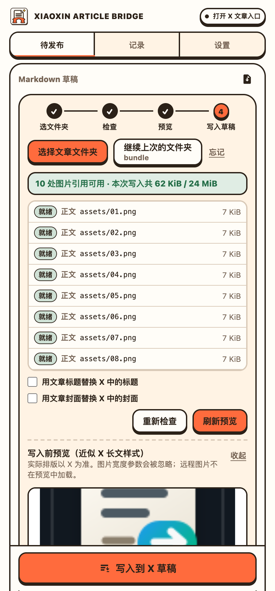
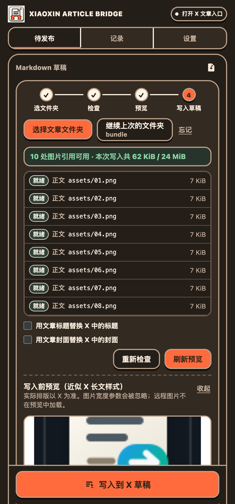
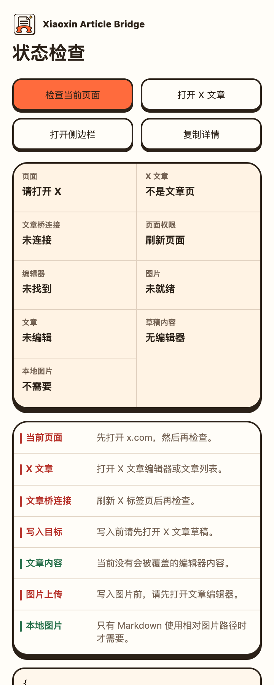

# 小新文章桥 · Xiaoxin Article Bridge

将 Markdown 文章和本地配图整包导入 X Articles 草稿：先检查缺图、必要时在本地压缩大图、预览效果，再写入草稿。默认保留已设置的标题与封面，从不自动发布。

这是基于 xPoster 的独立开源分支，并非 X、Google、Obsidian 官方产品。保留原作者 [@xiaoxiaodong01](https://x.com/xiaoxiaodong01) 的贡献和 MIT 许可，见 [来源声明](THIRD_PARTY_NOTICES.md)。原上游仓库 github.com/nevertoday/xposter 目前已无法访问（2026-10-31 核对为 404），因此改为链接原作者的 X 主页。

**Chrome Web Store：尚未提交，未上架。** 当前从 GitHub Releases 下载解压版，不要把原版商店页面当作本分支的安装入口。

## 适合谁

在 Obsidian 或其他 Markdown 编辑器里写好文章，想将文字和配图搬进 X 长文章草稿的创作者。用于整包读取本地图片、减少重复选目录、提前处理大图，并保留已有标题封面。

## 怎么用

1. 解压 Release，在 Chrome 扩展管理开启开发者模式，选择“加载已解压的扩展程序”。其他 xPoster 版本先停用，不必卸载。
2. 侧栏顶部的步骤条依次是：**选文件夹 → 检查 → 预览 → 写入草稿**。点击“选择文章文件夹”，选包含 article.md 和 assets 的目录。
3. 看检查列表：每张图的状态、大小，压缩过的会显示“压缩前 → 压缩后”。
4. 点“预览效果”，确认标题、封面、正文、图片位置和表格。
5. 点“写入到 X 草稿”。到 X 页面再检查一遍，最后自行发布。

## v1.2 新增

侧栏、诊断页、按钮和状态色对齐小新的个人视觉：暖纸色、墨色描边、橙色强调、圆角卡片与底部实色阴影。明暗主题覆盖 320/360/420px 侧栏。全新制作的“文章 + 桥 + 星光”图标替换上游图标；原作者署名和许可保留。详见 [图标与宣传图](docs/brand/README.md) 和 [更新记录](CHANGELOG.md)。

以上为隔离浏览器真实截图，使用人工构造的公开样例。真实 X 草稿写入仍待小新本人验证；不自动发布。

## v1.1 功能

- **记住上次的文件夹**：用 Chrome 的文件系统访问接口记住目录。重开侧栏后点“继续上次的文件夹”即可；如 Chrome 要求，会弹出一次读取权限确认。点“忘记”可清除。
- **超大图片本地压缩**：单张超过 5 MiB，或引用图片合计超过 24 MiB 时，在本机用 canvas 重新编码（保持比例，长边最多 4096 像素；有透明的用 WebP，否则用 JPEG，质量逐级降低）。列表显示压缩前后大小。原文件不改动，压缩结果只存在内存里。GIF 不压缩（会丢动画），过大时给出提示。
- **写入前预览**：在侧栏中用接近 X 长文的样式显示标题、封面、正文、图片位置和表格。解析、正文格式和表格转图片复用写入端的函数；它是近似效果，最终以 X 为准。
- **识别 Obsidian 图片语法**：支持 `![[图片.png]]`、`![[图片.png|300]]`（含句中嵌入）及属性里的 `cover: "[[封面.png]]"`。按“同级目录 → assets/ → 文件夹内唯一同名文件”的顺序查找。`|300` 这类宽度会被忽略，因为 X 长文不支持自定义图片宽度。
- **侧栏改版**：暖白底、墨色描边卡片、清晰步骤条，以及空、加载、错误、完成状态。

## 限制

支持 PNG/JPEG/WebP/GIF；引用的本地图片合计最多 24 MiB（压缩后计算），本地单张硬上限 16 MiB，Markdown 最多 512 KiB；单个文件夹最多扫描 3000 个 Markdown/图片文件，会跳过 `.obsidian`、`.git`、`node_modules` 等目录，请选文章文件夹而不是整个知识库。压缩阈值 5 MiB 是保守值，X 的实际上限可能变化。没有 File System Access 接口时退回普通目录选择，此时无法记住文件夹。表格写入时会转为图片。不自动发布，不提供 AI 生图，不需要 AI API Key。X 的文章权限由 X 决定。

## 常见问题

- **Obsidian 能直接用吗？** 可以选单篇文章的文件夹；不是 Obsidian 插件，不会同步整个知识库。
- **压缩会改我的原图吗？** 不会。只在内存里生成副本用于写入，关闭侧栏即释放。
- **记住文件夹会保存文章内容吗？** 目录记忆本身只保存一个由 Chrome 管理的目录句柄，不复制文件内容；读取权限由 Chrome 控制。编辑器另外会按隐私说明在本机保存草稿。
- **能保留公众号所有排版吗？** 不能。它针对 X Articles 的结构化正文，不复制公众号专用 HTML 样式。
- **预览通过就代表上传成功吗？** 不代表，必须检查目标草稿。
- **完全不联网吗？** 检查、压缩和预览都在本机完成，预览不加载远程图片；写入时内容会发给 X，远程图片会访问图片网站。
- **有广告或订阅吗？** 没有广告、订阅或开发者遥测。

[隐私说明](docs/privacy.zh-CN.md) · [使用说明](docs/usage.zh-CN.md) · [上架 Chrome 商店清单](docs/store-checklist.zh-CN.md) · [问题反馈](https://github.com/zds-xiaoxin/xiaoxin-article-bridge/issues)

v1.2 的单元测试和隔离浏览器测试（选文件夹、检查、压缩、预览、重开后继续上次的文件夹）已通过；写入真实 X 草稿这一步需要登录的 X 账号，正式使用前需由维护者本人验证，见 [验证记录](docs/verification.md)。没有声称对所有账号或未来的 X 页面有效。公开测试素材为人工构造，不包含私人文章或客户图片。
