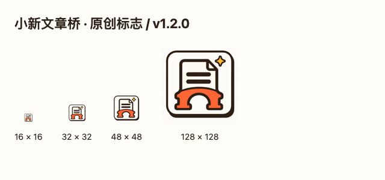
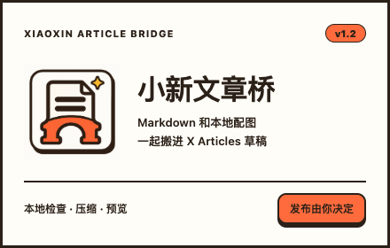

# 小新文章桥 v1.2 视觉资源

全新制作的文章纸张、拱桥和星光标志，呼应小新卡通冒险者 IP 的暖纸、墨线、橙色与星光元素。未复制上游图标，也未将整个扩展宣称为原创；原作者署名和 MIT 许可保留在 README、LICENSE 与 THIRD_PARTY_NOTICES。

- `article-bridge-master.png`：免费 Codex 内置生图生成的原始母图，未调用付费生图 API。图标仅做等比例缩小导出。
- `../../assets/icon-{16,32,48,128}.png`：扩展实际使用的图标，16px 保留橙色拱桥主轮廓。
- `store-icon-128.png`：商店用图标，96px 主体，四周 16px 透明边距。
- `promotional-440x280.png`：440×280 宣传图，图标搭配可重建的中文排版。
- `promotional-440x280.html`：宣传图排版源文件。
- `identity-preview.png`：四个图标的实际像素尺寸预览。

界面字体、颜色与阴影合同见 `../../xiaoxin-brand.css`。深色界面使用暖墨棕色纸面、浅墨线和橙色，保持阅读对比度；文章效果预览保留接近 X 的白色纸面。

重建宣传图与预览：`node scripts/export-brand.cjs`。需要已有 Playwright 及 Chromium，可用环境变量 `PLAYWRIGHT_MODULE` 指向兼容环境；不会安装依赖。导出只访问本地图片，不使用登录资料。

状态：已技术检查和制作方目视检查，仍待小新确认视觉并决定商店使用；没有提交商店。
